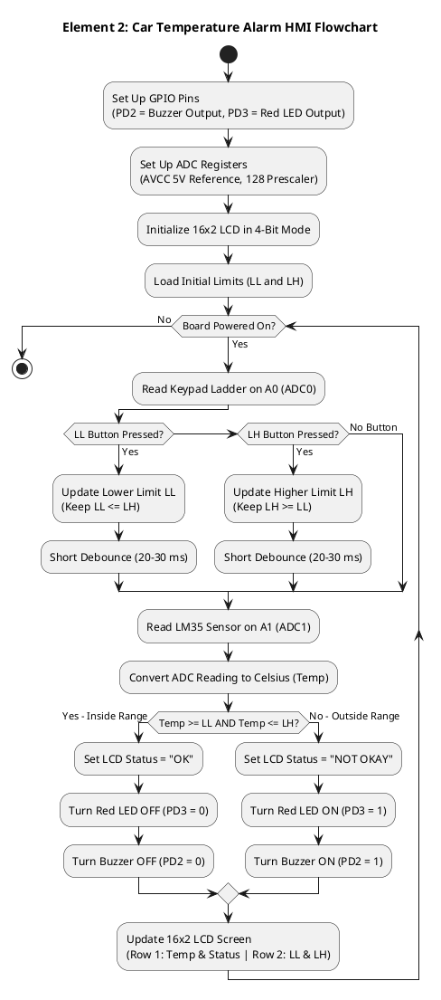

# Element 2: Car Temperature Alarm HMI — Program Flowchart

This flowchart shows how our bare-metal C code in `projectApp.ino` runs from startup through the main loop: initializing the pins, ADC, and 16x2 LCD, reading the two limit buttons (`LL` and `LH`) on `A0`, reading the **LM35** sensor on `A1`, and switching the LCD status, Red LED (`D3`), and buzzer (`D2`).

